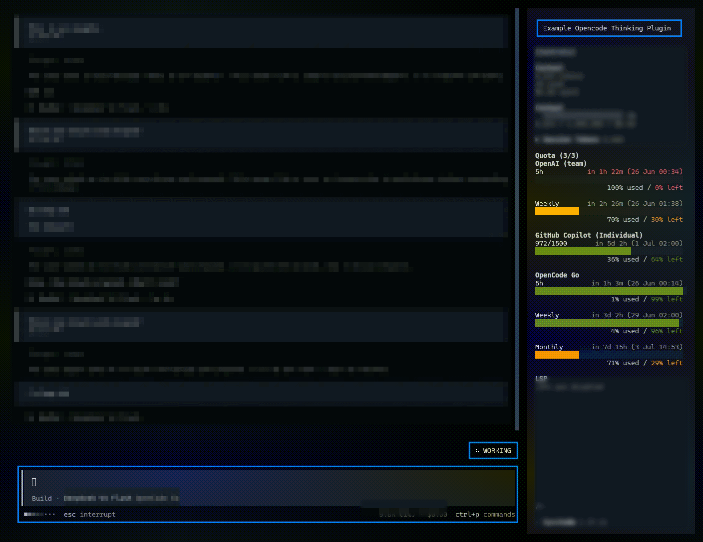
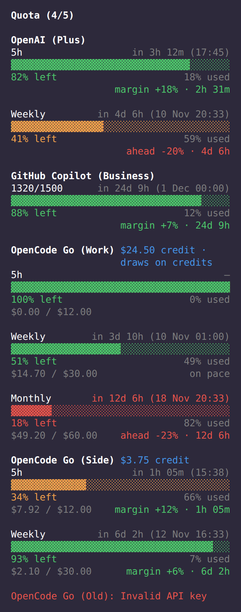

# OpenCode Plugins by arandevcode

Suite de plugins para [OpenCode](https://opencode.ai).

<br>
<p align="center">🐟</p>
<p align="center">
  <em>&ldquo;Quien quiera peces que se moje el culo&rdquo;</em><br>
  <sub>— mi padre me enseñó eso</sub>
</p>
<p align="center">
  <a href="https://buymeacoffee.com/arandevcode"><strong>☕ Invítame un café</strong></a>
  <br>
  <sub><a href="https://github.com/sponsors/arandevcode">❤️ Sponsor en GitHub</a></sub>
</p>

> 🇬🇧 Also available in [English](README.md)

> 🔁 ¿Quieres lo mismo en Claude Code? Mira [claude-mods](https://github.com/arandevcode/claude-mods).

| Plugin | Tipo | npm | Versión | Descripción |
|--------|------|-----|---------|-------------|
| opencode-thinking | `🧩 plugin` | `@arandevcode/opencode-thinking` | 0.3.0 | Indicadores animados de pensamiento con borde arcoíris e IDLE según el tema |
| opencode-quota-extended | `🧩 plugin` | `@arandevcode/opencode-quota-extended` | 0.3.2 | Cuota, gasto y balance de OpenCode Go vía API key personal, con tarjetas por ventana + CLI |

## Instalación

```bash
opencode plugin --global --force @arandevcode/opencode-thinking
opencode plugin --global --force @arandevcode/opencode-quota-extended
```

Ambos plugins funcionan en OpenCode 1.x y en OpenCode 2 (preliminar). En OpenCode 2 se instalan con `opencode plugin add <paquete>`; el README de cada plugin tiene una tabla de compatibilidad.

## Desinstalación

Los dos plugins son independientes. Elige el/los que quieras quitar y sigue los pasos.

### Desinstalar `opencode-thinking`

1. Quita la entrada del plugin en `~/.config/opencode/opencode.json`:

   ```jsonc
   {
     "plugin": [
       "@arandevcode/opencode-thinking/tui",   // ← eliminar
       "@arandevcode/opencode-thinking/server" // ← eliminar
     ]
   }
   ```

2. Borra el archivo de estado compartido:

   ```sh
   rm -f ~/.config/opencode/thinking-visual-state.json
   rm -f ~/.config/opencode/thinking-visual-debug.log
   ```

3. (Opcional) Borra un clon local del repo:

   ```sh
   rm -rf ./opencode-thinking
   ```

Reinicia OpenCode.

### Desinstalar `opencode-quota-extended`

1. Quita la entrada del plugin en `~/.config/opencode/opencode.json`:

   ```jsonc
   {
     "plugin": [
       "@arandevcode/opencode-quota-extended",       // ← eliminar
       "@arandevcode/opencode-quota-extended/tui",   // ← eliminar
       "@arandevcode/opencode-quota-extended/server" // ← eliminar
     ]
   }
   ```

2. Borra la sidecar opcional y las credenciales de OpenCode Go (solo si las creaste):

   ```sh
   rm -f ~/.config/opencode/opencode-quota-extended.json
   rm -rf ~/.config/opencode/opencode-quota
   ```

3. (Opcional) Borra el CLI global:

   ```sh
   npm rm -g @arandevcode/opencode-quota-extended
   ```

4. (Opcional) Borra un clon local del repo:

   ```sh
   rm -rf ./opencode-quota-extended
   ```

Reinicia OpenCode. **Nota:** ninguno de los dos plugins toca `~/.local/share/opencode/auth.json` — tus tokens de auth nunca se modifican.

<p align="center">
  
  &nbsp;&nbsp;&nbsp;
  
  <br>
  <sub><em>thinking demo</em> &nbsp;&nbsp;&nbsp;&nbsp;&nbsp;&nbsp;&nbsp;&nbsp; <em>quota sidebar</em></sub>
</p>

## 🧭 Filosofía

- 🆓 **Siempre gratis y open source** — sin suscripciones, sin versiones de pago, sin barreras
- 🔒 **Todo local, sin fugas** — cero telemetría, cero exfiltración
- ⚡ **Ligero** — mínimas dependencias, arranque rápido, consumo ajustado
- 🎯 **Propósito único** — cada plugin resuelve un problema y lo hace bien
- 🤝 **Abierto a colaboración** — issues, PRs, sugerencias bienvenidas
- 📖 **Transparencia radical** — dependencias y limitaciones documentadas explícitamente
- 🧩 **Autónomo** — cada plugin funciona solo, sin acoplamientos ocultos
- 🐐 **A hombros de gigantes** — acreditamos cada dependencia e inspiración

### ✅ Cumplimiento

| Plugin | Gratis y OSS | Solo local | Ligero | Propósito único | Transparencia | Autónomo | Gigantes |
|--------|---|---|---|---|---|---|---|
| opencode-thinking | ✅ | ✅ | ✅ | ✅ | ✅ | ✅ | ✅ original |
| opencode-quota-extended | ✅ | ✅¹ | ✅ | ✅ | ✅ | ✅ | ✅ inspirado por [`@slkiser/opencode-quota`](https://github.com/slkiser/opencode-quota) |

> **Notas:** ¹ consulta APIs externas de cuota por diseño — sin exfiltración de datos locales.

## Licencia

MIT © 2026 arandevcode
