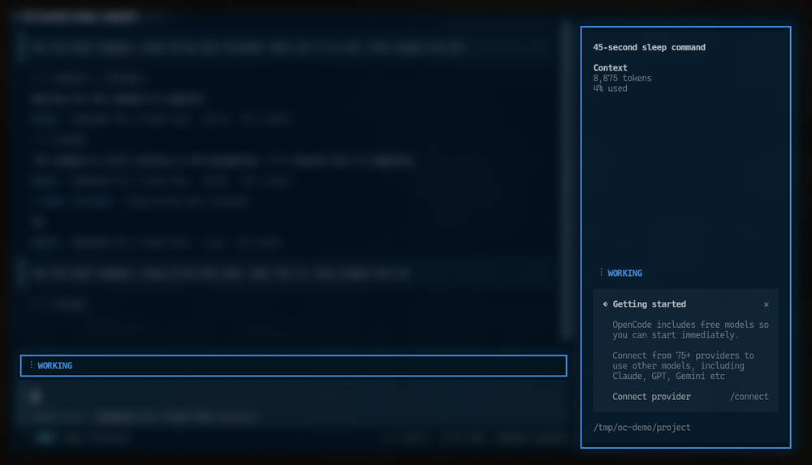
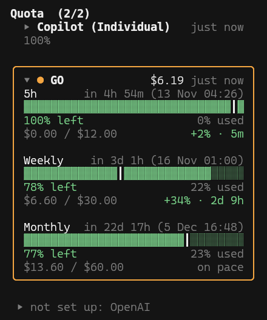

# OpenCode Plugins by arandevcode

Suite of plugins for [OpenCode](https://opencode.ai).

<br>
<p align="center">🐟</p>
<p align="center">
  <em>&ldquo;Quien quiera peces que se moje el culo&rdquo;</em><br>
  <em>&ldquo;If you want fish, get your ass wet&rdquo;</em><br>
  <sub>— my father taught me that</sub>
</p>
<p align="center">
  <a href="https://buymeacoffee.com/arandevcode"><strong>☕ Buy me a coffee</strong></a>
  <br>
  <sub><a href="https://github.com/sponsors/arandevcode">❤️ Sponsor on GitHub</a></sub>
</p>

> 🇪🇸 También disponible en [Español](README-es.md)

> 🔁 Want the same on Claude Code? See [claude-mods](https://github.com/arandevcode/claude-mods).

| Plugin | Type | npm | Version | Description |
|--------|------|-----|---------|-------------|
| opencode-thinking | `🧩 plugin` | `@arandevcode/opencode-thinking` | 0.5.0 | WORKING / WAITING / IDLE status band with subagent-aware state, theme-aware border + sidebar |
| opencode-quota-extended | `🧩 plugin` | `@arandevcode/opencode-quota-extended` | 0.5.0 | OpenCode Go quota/spend/balance via personal API key, session-aware per-window cards with pace tick, reading age + stale fallback + CLI |

## Install

```bash
opencode plugin --global --force @arandevcode/opencode-thinking
opencode plugin --global --force @arandevcode/opencode-quota-extended
```

Both plugins work on OpenCode 1.x and OpenCode 2 (preview). On OpenCode 2 install with `opencode plugin add <package>`; each plugin's README has a compatibility table.

To update on OpenCode 2, use `opencode plugin update <package>`; `opencode plugin add` is only for the first install.

## Uninstall

The two plugins are independent. Pick the one(s) you want to remove and follow the steps.

### Uninstall `opencode-thinking`

1. Remove the plugin entry from `~/.config/opencode/opencode.json`:

   ```jsonc
   {
     "plugin": [
       "@arandevcode/opencode-thinking/tui",   // ← remove
       "@arandevcode/opencode-thinking/server" // ← remove
     ]
   }
   ```

2. Delete the shared state file:

   ```sh
   rm -f ~/.config/opencode/thinking-visual-state.json
   rm -f ~/.config/opencode/thinking-visual-debug.log
   ```

3. (Optional) Remove a local source clone:

   ```sh
   rm -rf ./opencode-thinking
   ```

Restart OpenCode.

### Uninstall `opencode-quota-extended`

1. Remove the plugin entry from `~/.config/opencode/opencode.json`:

   ```jsonc
   {
     "plugin": [
       "@arandevcode/opencode-quota-extended",       // ← remove
       "@arandevcode/opencode-quota-extended/tui",   // ← remove
       "@arandevcode/opencode-quota-extended/server" // ← remove
     ]
   }
   ```

2. Delete the optional sidecar config and OpenCode Go credentials (only if you created them):

   ```sh
   rm -f ~/.config/opencode/opencode-quota-extended.json
   rm -rf ~/.config/opencode/opencode-quota
   ```

3. (Optional) Remove the global CLI:

   ```sh
   npm rm -g @arandevcode/opencode-quota-extended
   ```

4. (Optional) Remove a local source clone:

   ```sh
   rm -rf ./opencode-quota-extended
   ```

Restart OpenCode. **Note:** neither plugin ever touches `~/.local/share/opencode/auth.json` — your auth tokens are never modified.

<p align="center">
  
  &nbsp;&nbsp;&nbsp;
  
  <br>
  <sub><em>thinking states</em> &nbsp;&nbsp;&nbsp;&nbsp;&nbsp;&nbsp;&nbsp; <em>quota sidebar</em></sub>
</p>

## 🧭 Philosophy

- 🆓 **Always free and open source** — no subscriptions, no paid tiers, no gatekeeping
- 🔒 **All runs locally, no data leak** — zero telemetry, zero exfiltration
- ⚡ **Lightweight** — minimal deps, fast startup, low resource usage
- 🎯 **Single purpose** — each plugin solves one problem and does it well
- 🤝 **Open to collaboration** — issues, PRs, suggestions welcome
- 📖 **Radical transparency** — dependencies & limitations explicitly documented
- 🧩 **Self-contained** — each plugin stands alone, no hidden coupling
- 🐐 **Standing on giants** — we credit every dependency and inspiration

### ✅ Compliance

| Plugin | Free & OSS | Local only | Light | Single purpose | Transparency | Self-contained | Giants |
|--------|---|---|---|---|---|---|---|
| opencode-thinking | ✅ | ✅ | ✅ | ✅ | ✅ | ✅ | ✅ original |
| opencode-quota-extended | ✅ | ✅¹ | ✅ | ✅ | ✅ | ✅ | ✅ inspired by [`@slkiser/opencode-quota`](https://github.com/slkiser/opencode-quota) |

> **Notes:** ¹ fetches external quota APIs by design — no local data exfiltration.

## License

MIT © 2026 arandevcode
