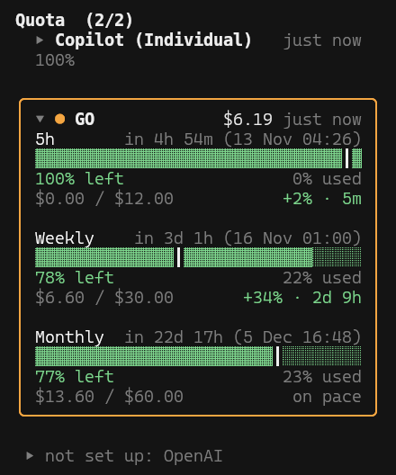
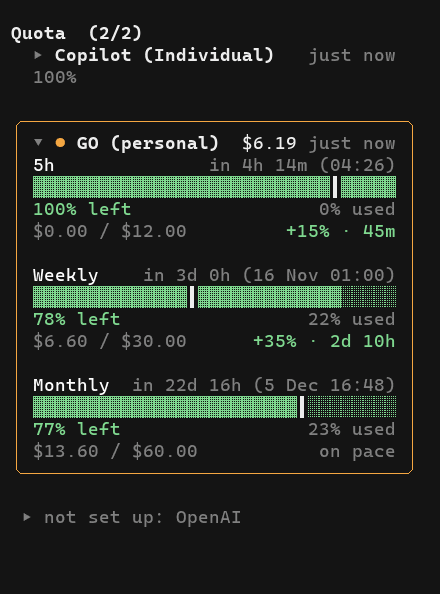
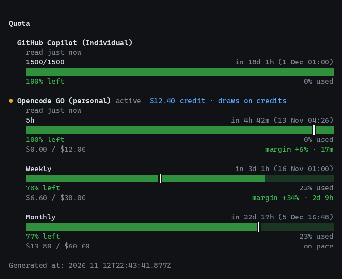

<table align="center">
  <tr>
    <td align="center" valign="top">
      
      <br>
      <sub><em>Una sesión real de OpenCode 2: Copilot y OpenCode Go configurados, el de esta sesión desplegado y OpenAI plegado en una sola línea &ldquo;not set up&rdquo;</em></sub>
    </td>
    <td align="center" valign="top">
      
      <br>
      <sub><em>Clic en una cabecera para plegar o desplegar la tarjeta; la cuenta activa (<code>GO (personal)</code>) conserva su marco. Sesión real, importes inventados, puntero dibujado</em></sub>
    </td>
  </tr>
</table>

# @arandevcode/opencode-quota-extended

> 🇬🇧 Also available in [English](README.md)

> 🔁 ¿Quieres esto en Claude Code? Mira [quota-panel](https://github.com/arandevcode/claude-mods/tree/main/quota-panel).

Tarjetas de uso de cuota para la barra lateral TUI — barras de progreso por ventana con colores de semáforo para OpenAI, GitHub Copilot y OpenCode Go.

- Barra de progreso para cada ventana de cuota (5h móvil, semanal, mensual, code review...)
- Una marca amarilla de ritmo indica cuánto queda por delante de la ventana, para comparar de un vistazo la cuota restante con el reloj
- Muestra cuándo se reinicia — tiempo restante y fecha exacta
- Indicador de salud por colores (verde = ok, naranja = advertencia, rojo = crítico)
- Antigüedad de cada lectura, aviso ámbar cuando los datos están caducados y marca cuando una ventana se reseteó después de la lectura
- ¡Compatible con OpenCode Go!

Inspirado por [`@slkiser/opencode-quota`](https://github.com/slkiser/opencode-quota). Ambos coexisten sin conflicto.

<br>
<p align="center">🐟  <em>&ldquo;Quien quiera peces que se moje el culo&rdquo;</em>  <sub>— para mi padre, que me enseñó a arremangarme y hacer que las cosas pasen</sub>
</p>

<p align="center">
  <a href="https://buymeacoffee.com/arandevcode"><strong>☕ Invítame un café</strong></a>
  <br>
  <sub><a href="https://github.com/sponsors/arandevcode">❤️ Sponsor en GitHub</a></sub>
</p>

## Instalación

Un solo paquete para las dos generaciones de OpenCode: trae una entrada para cada una y carga la que toca.

### OpenCode 1.x

```sh
opencode plugin --global --force @arandevcode/opencode-quota-extended
```

O instala desde GitHub para seguir el desarrollo más reciente:

```json
// ~/.config/opencode/opencode.json
{
  "plugin": [
    "https://github.com/arandevcode/opencode-plugins/tree/main/opencode-quota-extended"
  ]
}
```

### OpenCode 2 (versión preliminar)

```sh
opencode plugin add @arandevcode/opencode-quota-extended
```

En OpenCode 2 el comando es `plugin add` (no `plugin --global`). El soporte para OpenCode 2 es nuevo; si ves algo raro, [abre un issue](https://github.com/arandevcode/opencode-plugins/issues).

### Actualizar en OpenCode 2

```sh
opencode plugin check
opencode plugin update
```

`opencode plugin add` es solo para la primera instalación. Si lo ejecutas otra vez con otro spec (por ejemplo `...@latest`), añade una segunda entrada en vez de actualizar la existente ([anomalyco/opencode#56217](https://github.com/anomalyco/opencode/issues/56217)); OpenCode carga las dos copias y una puede aparecer como `failed`. Si te pasa, elimina la entrada extra con `opencode plugin remove <spec-duplicado>` y recarga.

Sin target, `plugin update` actualiza todos los plugins desactualizados. Pásale el spec del paquete para actualizar solo uno.

### Compatibilidad

| Función | OpenCode 1.x | OpenCode 2 |
|---|---|---|
| Tarjetas de cuota en la barra lateral | ✅ | ✅ |
| Cuota en vivo de OpenAI y Copilot | ✅ | ✅ usa los inicios de sesión de OpenCode 2 (si no hay, usa el `auth.json` de OpenCode 1.x y lo indica) |
| Cuota en vivo de OpenCode Go | ✅ | ⚠️ clave de API por variable de entorno o archivo auxiliar; aún no se lee de OpenCode 2 |
| CLI `quota` | ✅ | ✅ (no depende de OpenCode) |

## Desinstalación

**OpenCode 2:** ejecuta `opencode plugin remove @arandevcode/opencode-quota-extended` y después, si quieres, los pasos opcionales de limpieza de abajo.

**OpenCode 1.x:** Cuatro pasos, en orden:

1. Quita la entrada del plugin en la config de OpenCode (`~/.config/opencode/opencode.json`):

   ```jsonc
   // borra las líneas de @arandevcode/opencode-quota-extended dentro de "plugin": []
   {
     "plugin": [
       "@arandevcode/opencode-quota-extended", // ← eliminar
       "@arandevcode/opencode-quota-extended/tui",  // ← eliminar
       "@arandevcode/opencode-quota-extended/server" // ← eliminar
     ]
   }
   ```

2. Borra la sidecar de config opcional y el archivo de credenciales de OpenCode Go (solo si los creaste):

   ```sh
   rm -f ~/.config/opencode/opencode-quota-extended.json
   rm -rf ~/.config/opencode/opencode-quota
   ```

3. (Opcional) Borra el binario CLI global si lo instalaste:

   ```sh
   npm rm -g @arandevcode/opencode-quota-extended
   ```

4. (Opcional) Borra cualquier clon local del repo que hayas usado para seguir el desarrollo:

   ```sh
   rm -rf ./opencode-quota-extended
   ```

Reinicia OpenCode y el panel de Quota desaparecerá. **Nota:** el plugin **no** toca `~/.local/share/opencode/auth.json` — tus tokens de auth nunca se modifican.

## CLI

Visualiza la cuota desde la terminal sin abrir el TUI:

```sh
npx opencode-quota            # ejecutar vía npm (sin instalar)
opencode-quota                # si está instalado globalmente
node bin/quota.mjs            # desde el directorio del repo (sin build)
npm run quota                 # desde el directorio del repo
```

<p align="center">
  
  <br>
  <sub><em>La CLI <code>quota</code>: cuenta activa marcada con <code>●</code>, marca de ritmo en cada barra y el texto de ritmo a la derecha</em></sub>
</p>

Colores de semáforo: verde (ok), naranja (advertencia), rojo (error). Todos los colores vienen del tema activo de OpenCode — se adaptan automáticamente a la paleta del usuario.

Cada proveedor muestra también la antigüedad de su lectura (`just now`, `2m ago`). Si la última consulta falla, la CLI conserva la última lectura correcta y la marca como caducada en vez de eliminar la tarjeta. La cuenta de OpenCode Go que el selector de cuentas marca como activa (`opencode-go-active.json`) lleva un `●` y la palabra `active`, cada barra tiene la misma marca de ritmo que la sidebar, y el ritmo (`margin +34% · 2d 9h`, `ahead -12% · 1h 20m` u `on pace`) va a la derecha de la fila de gasto.

## Configuración

Archivo sidecar opcional en `~/.config/opencode/opencode-quota-extended.json`:

| Campo | Tipo | Por defecto | Descripción |
|---|---|---|---|
| `enabledProviders` | string[] | `["openai","github-copilot","opencode-go"]` | Proveedores a consultar |
| `refreshIntervalMs` | int | `60000` | Intervalo de sondeo; una lectura se considera caducada tras 3× este valor |
| `cardsSidebar.order` | int | `145` | Posición en la barra lateral (menor = más arriba) |

## Más Información

### Cómo funciona

Registra un plugin TUI que renderiza un panel `sidebar_content` en la posición 145, mostrando tarjetas de cuota para cada proveedor activo, más una línea `sidebar_footer` con la versión de OpenCode del host. Cada proveedor obtiene datos de cuota independientemente desde su propia API.

| Proveedor | Ventanas | Fuente de autenticación |
|---|---|---|
| **OpenAI** | 5h móvil, Semanal, Code Review | `auth.json` → entrada `openai` / `chatgpt` |
| **GitHub Copilot** | Solicitudes Premium (ventana única) | `auth.json` → entrada `github-copilot` |
| **OpenCode Go** | 5h, Semanal, Mensual + gasto | API key personal (o cookie de sesión legacy) |

Colores de semáforo: ≥50% `theme.success` (verde), 25-49% `theme.warning` (naranja), <25% `theme.error` (rojo).

Cada tarjeta muestra la antigüedad de su lectura en la misma línea que el nombre del proveedor, p. ej. `2m ago`. Una lectura está caducada cuando supera tres periodos de `refreshIntervalMs` (tres minutos con el intervalo por defecto de 60 s), o cuando la última consulta falló y sigue en pantalla la lectura anterior. La antigüedad pasa a ámbar:

```
⚠ 14m ago
run /connect, choose ChatGPT
```

Las tarjetas se adaptan a la sesión. El proveedor que usa la sesión actual empieza desplegado y lleva un carril izquierdo y un punto amarillos; el resto se contrae a dos líneas: nombre y antigüedad, y debajo un resumen compacto de ventanas (`5h 98% · wk 80% · mo 78%`) con el saldo. Así el nombre tiene más sitio; los proveedores conocidos se abrevian en sidebars estrechas (`GO (personal)`, `Copilot (Individual)`). Todas las tarjetas reservan las mismas columnas de borde, y la activa se enmarca con una línea amarilla sólida redondeada y un poco de espacio interior horizontal, así las filas activas e inactivas quedan alineadas. Haz clic en la cabecera (o en su línea de resumen) para desplegar o contraer. Cada sesión recuerda sus tarjetas abiertas, así que al cambiar de pestaña recuperas la vista que dejaste. Cuando la sesión usa OpenCode Go, la cuenta con nombre activa según `opencode-go-active.json` es la resaltada. El pie de la sidebar también muestra la versión de OpenCode del host (`OpenCode 2.2.5`). Los proveedores sin configurar (sin credenciales) no cuentan en la cabecera ni tienen tarjeta: se pliegan en una sola línea atenuada `not set up: OpenAI` que se despliega con los pasos de configuración. El proveedor que usa la sesión actual conserva siempre su tarjeta, así que si le falta la clave sigue viendo su aviso.

La acción reutiliza el hint de configuración existente para fallos de credenciales; en fallos de red indica que el panel reintenta automáticamente. Un reloj de UI de 30 s actualiza estas etiquetas sin hacer peticiones a las APIs. Si una ventana de cuota se reseteó después de tomar la lectura, la tarjeta añade `window reset since this reading` para que un porcentaje antiguo no se confunda con datos actuales.

La última instantánea se guarda en `$XDG_CACHE_HOME/opencode-quota-extended/last-snapshot.json` (`~/.cache/...` si no está definido; permisos `600`). Solo contiene cifras de cuota, nunca credenciales, y mantiene visibles las lecturas caducadas entre reinicios. Borrarlo es seguro.

### Autenticación

Lee credenciales del archivo de autenticación de OpenCode (`~/.local/share/opencode/auth.json`). **No** almacena, solicita ni distribuye secretos.

**OpenCode Go** usa una API key personal. El plugin llama al mismo endpoint del console que el dashboard y lee las tres ventanas de cuota, el gasto en dólares por ventana y el balance de crédito prepago.

Crea `~/.config/opencode/opencode-quota/opencode-go.json`:

```json
{
  "apiKey": "oc_sk_..."
}
```

| Campo | Descripción | Cómo obtenerlo |
|---|---|---|
| `apiKey` | API key personal de OpenCode | Abre [opencode.ai/console](https://opencode.ai/console) → **Personal API keys** → crea una key con permisos **All**. Copia el valor `oc_sk_...`. No uses una service account: no puede leer billing. |

La key se guarda con permisos `600` y solo se envía a `opencode.ai`. Una key **All** muestra cuota, gasto y balance. Una key `read` no sirve para este plugin: no puede llamar a `go/status`.

**Múltiples workspaces/cuentas:** cualquier archivo `opencode-go-<sufijo>.json` en el mismo directorio añade una sección extra `Opencode GO (<sufijo>)` (p. ej. `opencode-go-work.json` → **Opencode GO (work)**). El `opencode-go.json` base se muestra como **OpenCode Go** cuando está configurado; si no existe, se oculta mientras haya cuentas con nombre, para no mostrar un aviso de configuración de una cuenta que decidiste no crear. Los archivos `opencode-go-<sufijo>-key.json` que mantiene el switch de cuentas los ignora el plugin de cuota.

```sh
# p. ej. una segunda cuenta
cp ~/.config/opencode/opencode-quota/opencode-go.json \
   ~/.config/opencode/opencode-quota/opencode-go-work.json
# luego sustituye apiKey dentro de opencode-go-work.json
```

**Setup automatizado** (recomendado):
```sh
npm run setup            # cuenta base -> opencode-go.json
npm run setup work       # cuenta extra -> opencode-go-work.json
```
Te solicita la API key, escribe el archivo con permisos `600` e indica dónde crearla.

También puedes usar `OPENCODE_GO_API_KEY` en vez de un archivo.

**Legacy:** `{ "workspaceId": "wrk_...", "authCookie": "st_..." }` sigue aceptándose por compatibilidad, pero la cookie de sesión del navegador caduca. Mejor usa la API key.

**Migrar una cuenta existente:** si ya tienes `opencode-go-<Cuenta>.json`, sustituye todo su contenido por `{ "apiKey": "oc_sk_..." }`. No hacen falta `workspaceId` ni `authCookie`. `npm run setup <Cuenta>` respeta mayúsculas: el sufijo debe coincidir exactamente con el nombre del archivo.

### Relación con [`@slkiser/opencode-quota`](https://github.com/slkiser/opencode-quota)

**Sin dependencia.** Ambos plugins obtienen cuota independientemente y renderizan sus propios paneles laterales. Puedes tener uno, ambos o ninguno — no interfieren.

### Solución de problemas

- **El panel no aparece**: `grep '@arandevcode/opencode-quota-extended' ~/.local/share/opencode/log/*.log`
- **OpenCode Go muestra "skipped"**: confirma que el archivo sidecar o `OPENCODE_GO_API_KEY` está configurado
- **OpenCode Go muestra 401/403**: la key no es válida, ha caducado o le faltan permisos; crea una key personal **All** (las service account no pueden leer billing)
- **Los datos parecen antiguos o la línea de edad está en ámbar**: el panel muestra la última lectura correcta. Revisa la red o las credenciales; el hint de la línea indica qué hacer. Para empezar de cero, borra `$XDG_CACHE_HOME/opencode-quota-extended/last-snapshot.json`
- **Bug antiguo de pinning `@opentui/solid`**: usa `^0.4.1 || ^0.5.0` y reinstala limpio (`rm -rf node_modules && npm ci`)
- **El plugin aparece dos veces o una fila dice `failed`**: `plugin add` de OpenCode 2 puede añadir una segunda entrada del mismo paquete ([#56217](https://github.com/anomalyco/opencode/issues/56217)). Ejecuta `opencode plugin list`, elimina la entrada extra con `opencode plugin remove <spec>` y recarga.

### Desarrollo

```sh
npm run build        # compilar TS + copiar assets TUI
npm run build:watch  # modo watch
npm test             # vitest
npm run typecheck    # type-check sin emitir
```

### Patrones TUI y tema

Los colores se obtienen en vivo de `api.theme.current`. El mapeo de semáforo respeta el tema:

| Restante | Color (clave de tema) | Hex por defecto (AMOLED) |
|---|---|---|
| ≥50% | `theme.success` (verde) | `#00ff88` |
| 25-49% | `theme.warning` (naranja) | `#ffea00` |
| <25% | `theme.error` (rojo) | `#ff1744` |

La barra de progreso sigue el patrón gauge de `opentui-theme-colors`: un `<text>` por celda, `bg={themeColor}` en las celdas llenas y `bg={theme.backgroundElement}` en las vacías, con la etiqueta de porcentaje en primer plano con contraste correcto (`backgroundPanel` en lleno, `textMuted` en vacío). Es el mismo patrón que la barra de contexto en `@arandevcode/opencode-stats`.

La barra de ratio antigua con `flexGrow` y los hex hardcodeados (`#6b8e23`, `#ffa500`, `#ff6b6b`) ya no existen.

### Estructura del proyecto

```
src/
  index.ts            # Plugin module (entrada server)
  server.ts           # Plugin server (mínimo, sin herramientas)
  tui.tsx             # Plugin TUI: slots sidebar_content + sidebar_footer
  config/             # defaults, schema, loader
  lib/                # types, auth, http, formatting, freshness, caché de instantáneas
  providers/          # openai.ts, copilot.ts, opencode-go.ts, registry.ts
  ui/                 # SidebarPanel, cards, progress-bar
tests/                # tests unitarios vitest
```

## Licencia

MIT
