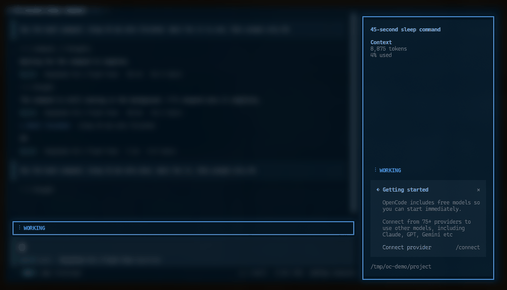
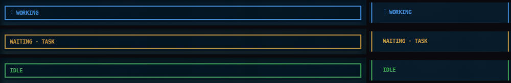

<p align="center">
  
  <br>
  <sub><em>WORKING → WAITING · TASK → IDLE en una sesión real de OpenCode 2 (todo lo que no es el plugin está desenfocado)</em></sub>
</p>

# @arandevcode/opencode-thinking

> 🇬🇧 Also available in [English](README.md)

> 🔁 ¿Quieres esto en Claude Code? Mira [glow-thinking](https://github.com/arandevcode/claude-mods/tree/main/glow-thinking).

Una banda de estado sobre el prompt y una línea de estado en la barra lateral que te dicen de un vistazo si OpenCode está ocupado, esperando trabajo en background o libre. En OpenCode 2 la barra lateral también lleva borde. **WORKING incluye a todos los subagentes**, en primer plano o en background. Sin configuración necesaria.

Funciona en OpenCode 1.x y OpenCode 2. Se ejecuta en local, sin telemetría y sin red.

<br>
<p align="center">🐟</p>
<p align="center">
  <em>&ldquo;Quien quiera peces que se moje el culo&rdquo;</em>
</p>
<p align="center">
  <sub>— para mi padre, que me enseñó a arremangarme y hacer que las cosas pasen</sub>
</p>

<p align="center">
  <a href="https://buymeacoffee.com/arandevcode"><strong>☕ Invítame un café</strong></a>
  <br>
  <sub><a href="https://github.com/sponsors/arandevcode">❤️ Sponsor en GitHub</a></sub>
</p>

## Estados

| Banda | Color | Significado |
|---|---|---|
| `WORKING` | colores del tema en rotación | El turno principal **o cualquier subagente** está en marcha, en primer plano o en background. |
| `WAITING · TASK` / `WAITING · 2 TASKS` | ámbar | El turno terminó pero sigue vivo un shell en background (solo OpenCode 2). |
| `IDLE` | verde | No hay nada en marcha ni pendiente. |

OpenCode 1.x no expone a los plugins TUI una señal fiable de shell en background, así que ahí la banda va directa de `WORKING` a `IDLE`; `WAITING` no se simula. Los monitores y despertares programados son conceptos de Claude Code sin equivalente aquí.

Cuando una tarea en background termina en OpenCode 2, despierta la sesión con un turno nuevo: la banda vuelve a `WORKING` y luego a `IDLE`.

<p align="center">
  
</p>

## Instalación

Un solo paquete para las dos generaciones de OpenCode: trae una entrada para cada una y carga la que toca.

### OpenCode 1.x

```sh
opencode plugin --global --force @arandevcode/opencode-thinking
```

O instala desde GitHub para seguir el desarrollo más reciente:

```json
// ~/.config/opencode/opencode.json
{
  "plugin": [
    "https://github.com/arandevcode/opencode-plugins/tree/main/opencode-thinking"
  ]
}
```

### OpenCode 2

```sh
opencode plugin add @arandevcode/opencode-thinking
```

En OpenCode 2 el comando es `plugin add` (no `plugin --global`). Si ves algo raro, [abre un issue](https://github.com/arandevcode/opencode-plugins/issues).

### Compatibilidad

| Función | OpenCode 1.x | OpenCode 2 |
|---|---|---|
| WORKING con turno principal + subagentes (primer plano y background) | ✅ | ✅ |
| `WAITING · TASK` para un shell en background vivo | ❌ sin señal fiable del plugin | ✅ |
| `WAITING · MONITOR` / `SCHEDULE` | ❌ sin equivalente | ❌ sin equivalente |
| Borde del prompt + banda de estado | ✅ | ❌ barra a todo el ancho encima del composer |
| Estado en la barra lateral | ✅ | ✅ |
| Borde alrededor de toda la barra lateral | ❌ | ✅ cuando la barra lateral está visible |
| Comando `/thinking_visual` | ✅ | ✅ |

En terminales muy estrechas OpenCode oculta la barra lateral; no hay nada que enmarcar, así que el borde no aparece.

## Actualizar

Actualiza el paquete con el comando de tu generación:

```sh
# OpenCode 1.x
opencode plugin --global --force @arandevcode/opencode-thinking@latest

# OpenCode 2
opencode plugin update @arandevcode/opencode-thinking
```

En OpenCode 2, `plugin add ...@latest` no es un comando de actualización: si el paquete ya está configurado, añade una segunda entrada y OpenCode carga las dos copias ([anomalyco/opencode#56217](https://github.com/anomalyco/opencode/issues/56217)). Usa `plugin update`; si ya tienes un duplicado, elimina la entrada extra con `opencode plugin remove <spec>`.

Después **reinicia la sesión**: un plugin ya cargado no se sustituye en una sesión en marcha. Recargar la ventana o la configuración no basta. Si el plugin está instalado en más de un ámbito (por ejemplo, el de usuario y el de un proyecto), actualiza cada uno.

Si lo instalaste desde GitHub o desde un clon local, actualiza esa fuente.

## Desinstalación

**OpenCode 2:** ejecuta `opencode plugin remove @arandevcode/opencode-thinking` y después, si quieres, los pasos opcionales de limpieza de abajo.

**OpenCode 1.x:** Tres pasos, en orden:

1. Quita la entrada del plugin en la config de OpenCode (`~/.config/opencode/opencode.json`):

   ```jsonc
   // borra las líneas de @arandevcode/opencode-thinking dentro de "plugin": []
   {
     "plugin": [
       "@arandevcode/opencode-thinking/tui",   // ← eliminar
       "@arandevcode/opencode-thinking/server" // ← eliminar
     ]
   }
   ```

2. Borra el archivo de estado compartido que usa el plugin para TUI ↔ Server:

   ```sh
   rm -f ~/.config/opencode/thinking-visual-state.json
   rm -f ~/.config/opencode/thinking-visual-debug.log
   ```

3. (Opcional) Borra cualquier clon local del repo que hayas usado para seguir el desarrollo:

   ```sh
   rm -rf ./opencode-thinking
   ```

Reinicia OpenCode y la banda de estado, el borde y el estado del sidebar desaparecerán.

## Comandos

| Comando | Efecto |
|---|---|
| `/thinking_visual` | Activar/desactivar todos los efectos |
| `/thinking_visual a` | Solo animación de borde |
| `/thinking_visual b` | Solo estado en la barra lateral |
| `/thinking_visual all` | Ambos |
| `/thinking_visual none` | Desactivar |

## Más Información

### Cómo se calcula el estado

El plugin vigila solo el **árbol de la conversación enfocada**. Las sesiones de otra conversación, aunque estén corriendo a la vez, nunca afectan a la banda.

- **OpenCode 1.x:** escucha `session.status` y `session.idle` de todas las sesiones y construye el mapa padre/hijo desde `parentID`. Al enfocar una conversación recorre el árbol con `session.children()` para incluir subagentes anidados. Solo las sesiones `busy`/`retry` cuentan como en marcha.
- **OpenCode 2:** lee el store de estado de sesiones, la familia de la sesión y la lista de shells en ejecución. Todo shell que siga vivo en el árbol enfocado cuenta como tarea pendiente.

Los subagentes son sesiones hijas normales en ambas versiones, así que primer plano y background usan la misma regla: **cualquier descendiente en marcha significa WORKING**.

Salir de `WORKING` tiene una pequeña **ventana de asentamiento de 400 ms**. Un subagente en primer plano puede parar unos milisegundos antes de que su padre reanude, y una tarea en background terminada despierta la sesión con un turno nuevo; la ventana evita que la banda parpadee a `IDLE`/`WAITING` en esos huecos. Entrar en `WORKING` es inmediato.

### Estructura del proyecto

```
├── src/
│   ├── index.ts        ← entrada del paquete
│   ├── tui.tsx         ← plugin TUI: banda, borde del prompt, sidebar, keymap
│   ├── v2.ts           ← adaptador del contexto de OpenCode 2 + snapshot de shells
│   ├── state.ts        ← máquina de estados compartida (WORKING > WAITING > IDLE)
│   ├── server.ts       ← plugin server v1: comando /thinking_visual
│   └── types.ts        ← tipos de config y ruta del archivo de estado
├── tests/              ← tests de la máquina de estados, TUI v1 y adaptador v2
├── docs/
│   └── ARCHITECTURE.md
├── images/
├── example.opencode.json
└── package.json
```

### Instalar en otro proyecto

```jsonc
// .opencode/opencode.json
{
  "plugin": [
    "@arandevcode/opencode-thinking/tui",
    "@arandevcode/opencode-thinking/server"
  ]
}
```

### Desarrollo

```sh
npm install        # instalar dependencias (solo type-check)
npm run build      # compilar src/ → dist/
npm test           # build + tests de estado, v1 y v2
npm run dev        # compilación continua
```

## Patrones TUI y tema

Los colores se obtienen en vivo de `api.theme.current`, no están hardcodeados. El plugin también vigila la firma del tema (sondeo de 250 ms) para que los cambios de tema a mitad de sesión se reflejen en el siguiente re-render.

| Estado | Color del borde y la insignia | Texto de la insignia |
|---|---|---|
| **Working** | cicla `theme.primary` → `theme.accent` → `theme.success` → `theme.error` cada 250 ms | `WORKING` |
| **Waiting** | `theme.warning` sólido | `WAITING · TASK` / `WAITING · 2 TASKS` |
| **Idle** | `theme.success` sólido | `IDLE` |

`theme.warning` queda deliberadamente fuera de la rotación de WORKING: el ámbar está reservado para `WAITING`, así una tarea pendiente en background no se confunde con el estado animado de trabajo. El mismo color impulsa el estado del sidebar y, en OpenCode 2, su borde cuando el modo visual `b` está activo.

Este patrón sigue la convención `opentui-theme-colors`: claves semánticas de tema (`primary` / `accent` / `success` / `warning` / `error`) en lugar de valores de paleta hardcodeados, y `themeSignature()` + `setInterval` para cambios de tema reactivos.

## Licencia

MIT
