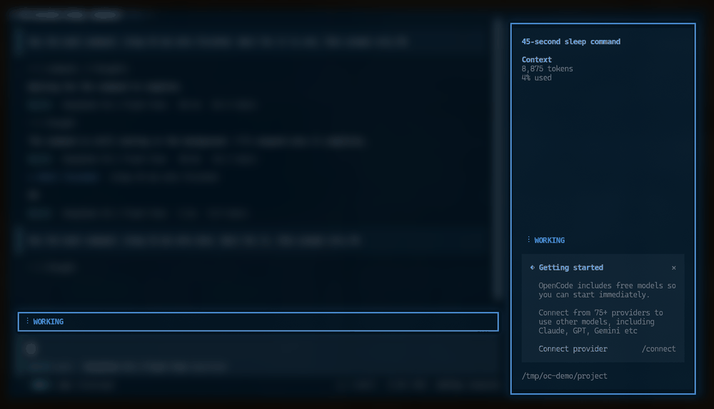
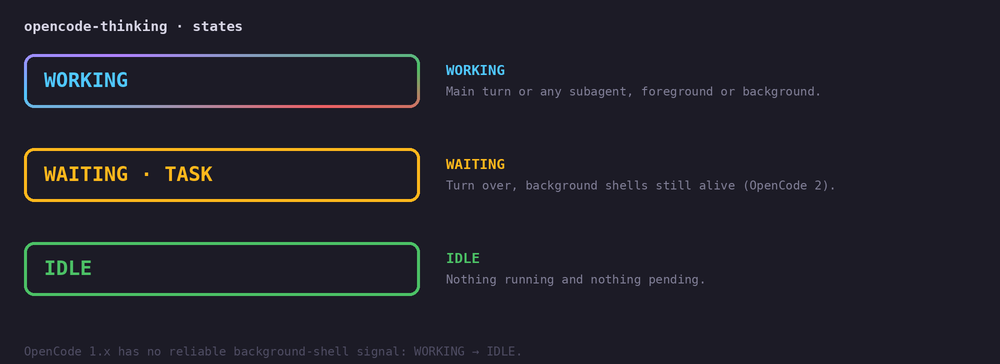

<p align="center">
  
  <br>
  <sub><em>WORKING → WAITING · TASK → IDLE over a turn with a subagent and a background task (made-up data)</em></sub>
</p>

# @arandevcode/opencode-thinking

> 🇪🇸 Also available in [Spanish](README-es.md)

> 🔁 Want this on Claude Code? See [glow-thinking](https://github.com/arandevcode/claude-mods/tree/main/glow-thinking).

A status band above the prompt and a state line in the sidebar that tell you, at a glance, whether OpenCode is busy, waiting on background work, or done. On OpenCode 2 the sidebar is framed too. **WORKING includes every subagent**, foreground or background. No config needed.

Works on OpenCode 1.x and OpenCode 2. Runs locally, no telemetry, no network.

<br>
<p align="center">🐟</p>
<p align="center">
  <em>&ldquo;Quien quiera peces que se moje el culo&rdquo;</em><br>
  <em>&ldquo;If you want fish, get your ass wet&rdquo;</em>
</p>
<p align="center">
  <sub>— for my father, who taught me to roll up my sleeves and get it done</sub>
</p>

<p align="center">
  <a href="https://buymeacoffee.com/arandevcode"><strong>☕ Buy me a coffee</strong></a>
  <br>
  <sub><a href="https://github.com/sponsors/arandevcode">❤️ Sponsor on GitHub</a></sub>
</p>

## States

| Band | Color | Meaning |
|---|---|---|
| `WORKING` | rotating theme colors | The main turn **or any subagent** is running, in the foreground or in the background. |
| `WAITING · TASK` / `WAITING · 2 TASKS` | amber | The turn is over but a background shell is still alive (OpenCode 2 only). |
| `IDLE` | green | Nothing running and nothing pending. |

OpenCode 1.x does not expose a reliable background-shell signal to TUI plugins, so there the band goes straight from `WORKING` to `IDLE`; `WAITING` is not simulated. Monitors and scheduled wakeups are Claude Code concepts with no equivalent here.

When a background task finishes in OpenCode 2 it wakes the session with a new turn, so the band goes back to `WORKING` and then to `IDLE`.

<p align="center">
  
</p>

## Install

One package for both OpenCode generations: it ships an entry for each and loads the right one.

### OpenCode 1.x

```sh
opencode plugin --global --force @arandevcode/opencode-thinking
```

Or install from GitHub source to follow latest development:

```json
// ~/.config/opencode/opencode.json
{
  "plugin": [
    "https://github.com/arandevcode/opencode-plugins/tree/main/opencode-thinking"
  ]
}
```

### OpenCode 2

```sh
opencode plugin add @arandevcode/opencode-thinking
```

On OpenCode 2 the plugin command is `plugin add` (not `plugin --global`). Please [open an issue](https://github.com/arandevcode/opencode-plugins/issues) if something looks wrong.

### Compatibility

| Feature | OpenCode 1.x | OpenCode 2 |
|---|---|---|
| WORKING with main turn + subagents (foreground and background) | ✅ | ✅ |
| `WAITING · TASK` for a live background shell | ❌ no reliable plugin signal | ✅ |
| `WAITING · MONITOR` / `SCHEDULE` | ❌ no equivalent | ❌ no equivalent |
| Prompt border + state band | ✅ | ❌ full-width bar above the composer |
| Sidebar state | ✅ | ✅ |
| Border around the whole sidebar | ❌ | ✅ when the sidebar is visible |
| `/thinking_visual` command | ✅ | ✅ |

On very narrow terminals OpenCode hides the sidebar; there is nothing to frame, so the border is absent there.

## Updating

Update the package with the command for your generation:

```sh
# OpenCode 1.x
opencode plugin --global --force @arandevcode/opencode-thinking@latest

# OpenCode 2
opencode plugin add @arandevcode/opencode-thinking@latest
```

Then **restart the session**: a loaded plugin is not replaced in a running session. Reloading the window or the configuration is not enough. If the plugin is installed in more than one scope (for example the user scope and a project), update each one.

If you installed from GitHub source or a local checkout, update that source instead.

## Uninstall

**OpenCode 2:** run `opencode plugin remove @arandevcode/opencode-thinking`, then do the optional clean-up steps below.

**OpenCode 1.x:** Three steps, in order:

1. Remove the plugin entry from your OpenCode config (`~/.config/opencode/opencode.json`):

   ```jsonc
   // delete the @arandevcode/opencode-thinking lines inside "plugin": []
   {
     "plugin": [
       "@arandevcode/opencode-thinking/tui",   // ← remove
       "@arandevcode/opencode-thinking/server" // ← remove
     ]
   }
   ```

2. Delete the shared state file the plugin uses for TUI ↔ Server IPC:

   ```sh
   rm -f ~/.config/opencode/thinking-visual-state.json
   rm -f ~/.config/opencode/thinking-visual-debug.log
   ```

3. (Optional) Remove any local source clone you may have used to follow development:

   ```sh
   rm -rf ./opencode-thinking
   ```

Restart OpenCode and the status band, border and sidebar state will be gone.

## Commands

| Command | Effect |
|---|---|
| `/thinking_visual` | Toggle all effects |
| `/thinking_visual a` | Border animation only |
| `/thinking_visual b` | Sidebar state only |
| `/thinking_visual all` | Both |
| `/thinking_visual none` | Disable |

## More Information

### How the state is calculated

The plugin watches only the **focused conversation's session tree**. Sessions from another conversation, even if they are running at the same time, never affect the band.

- **OpenCode 1.x:** listens to `session.status` and `session.idle` for every session and builds the parent/child map from `parentID`. When a conversation is focused, it walks the tree with `session.children()` so nested subagents are included. Only `busy`/`retry` sessions count as running.
- **OpenCode 2:** reads the session status store, the session family and the running shell list. Every shell still alive in the focused tree counts as a pending task.

Subagents are ordinary child sessions in both versions, so foreground and background subagents use the same rule: **any running descendant means WORKING**.

Leaving `WORKING` has a small **400 ms settle window**. A foreground subagent can stop a few milliseconds before its parent resumes, and a completed background task wakes the session with a new turn; the window keeps the band from flashing `IDLE`/`WAITING` in those gaps. Entering `WORKING` is immediate.

### Project structure

```
├── src/
│   ├── index.ts        ← package entry
│   ├── tui.tsx         ← TUI plugin: band, prompt border, sidebar, keymap
│   ├── v2.ts           ← OpenCode 2 context adapter + background-shell snapshot
│   ├── state.ts        ← shared tree/state machine (WORKING > WAITING > IDLE)
│   ├── server.ts       ← v1 server plugin: /thinking_visual command
│   └── types.ts        ← shared config types and state-file path
├── tests/              ← state machine, v1 TUI and v2 adapter tests
├── docs/
│   └── ARCHITECTURE.md
├── images/
├── example.opencode.json
└── package.json
```

### Install in another project

```jsonc
// .opencode/opencode.json
{
  "plugin": [
    "@arandevcode/opencode-thinking/tui",
    "@arandevcode/opencode-thinking/server"
  ]
}
```

### Development

```sh
npm install        # install deps (type-check only)
npm run build      # compile src/ → dist/
npm test           # build + state, v1 and v2 tests
npm run dev        # continuous compilation
```

## TUI Patterns & Theme

Colors are sourced live from `api.theme.current`, not hardcoded. The plugin also watches the theme signature (250ms polling) so theme changes mid-session are picked up by the next re-render.

| State | Border + badge color | Badge text |
|---|---|---|
| **Working** | cycles `theme.primary` → `theme.accent` → `theme.success` → `theme.error` every 250ms | `WORKING` |
| **Waiting** | solid `theme.warning` | `WAITING · TASK` / `WAITING · 2 TASKS` |
| **Idle** | solid `theme.success` | `IDLE` |

`theme.warning` is deliberately excluded from the WORKING rotation: amber is reserved for `WAITING`, so a pending background task cannot be confused with the animated working state. The same color drives the sidebar state, and on OpenCode 2 the sidebar border while visual mode `b` is enabled.

This pattern follows the `opentui-theme-colors` convention: semantic theme keys (`primary` / `accent` / `success` / `warning` / `error`) instead of hardcoded palette values, and `themeSignature()` + `setInterval` polling for reactive theme changes.

## License

MIT
